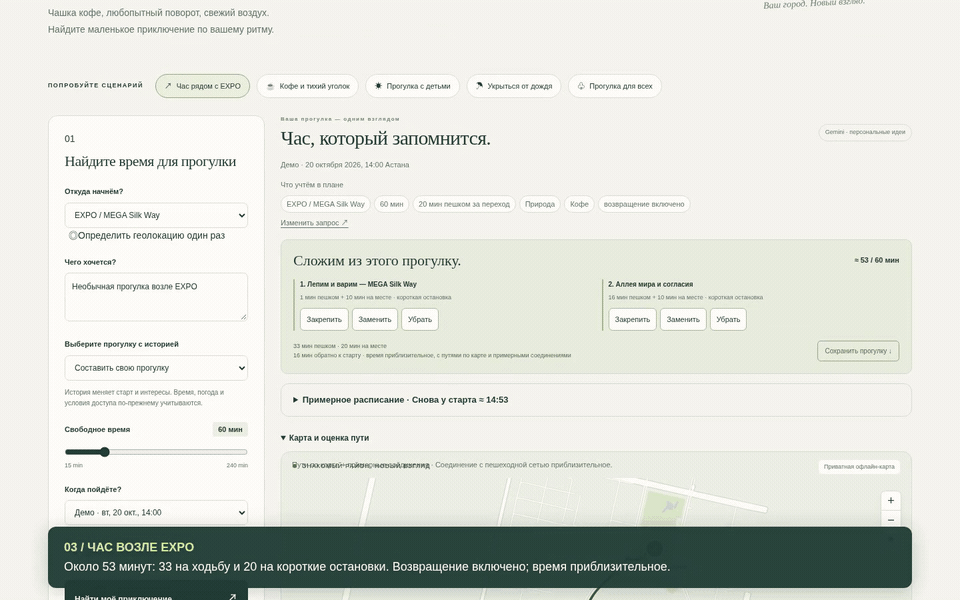

# Qadam · a little more Astana

**ArcSolo · Build with AI · Track 1 / Smart City**

An interactive Astana walking assistant that turns a short break into one editable itinerary with 1–3 source-backed stops that fits the available time, including the walk back. Every place explains its match, visit estimate, suggested activity and data uncertainty.

## Watch the demo

[](https://github.com/Csadow/qadam-astana/blob/main/presentation/Qadam_demo_RU.mp4)

**[▶ Full demo — 5:53, Russian captions](https://github.com/Csadow/qadam-astana/blob/main/presentation/Qadam_demo_RU.mp4)** · [Download MP4](https://github.com/Csadow/qadam-astana/raw/refs/heads/main/presentation/Qadam_demo_RU.mp4) · [Try the public planner](https://qadam-arcsolo-astana.candy-ball-8297.chatgpt.site)

The recording opens with the adaptive companion rehearsal (from 0:14): an unavailable café, lost time, rain and the original return deadline. It then demonstrates live Gemini, itinerary editing, group preferences, source-backed stories and time constraints. The 353-second video comes from a recording session with 19 successful live Gemini responses, 3 labelled template fallbacks and no browser errors. The public planner runs without paid generation.

## Run in one command

Requires **Node 22.9+**. No npm installation or model key is required.

```sh
git clone https://github.com/Csadow/qadam-astana.git
cd qadam-astana
node --env-file-if-exists=.env server.mjs
```

Open **http://127.0.0.1:8787**. The checked-in snapshot makes the local demo independent of public data services. Local serving binds only to loopback. To change the port, set `PORT` in `.env`.

The repository is **public**: judges can read or clone it without an invitation. The [public judge preview](https://qadam-arcsolo-astana.candy-ball-8297.chatgpt.site) runs the planner, maps and sources without paid generation. Live Gemini is available in the local app with a server-side key and demonstrated in the recorded walkthrough. See [submission status](docs/SUBMISSION.md).

## Signature feature: Walk with me

**“The café is unavailable, and we have lost 15 minutes. What can we still do?”**

Choose **Try Walk with me** on the opening screen. It starts a labelled EXPO rehearsal with a 15:00 return deadline and five-minute reserve; ending it restores your previous plan. Report **Unavailable on arrival**, **Lose 15 minutes**, and **Rain started**. The remaining walk is recomputed from the manually confirmed place. The **original return point, absolute deadline and reserve stay fixed**. Finished/unavailable stops are excluded, and changes are visible. If no visit fits, Qadam shows a return estimate; an unreachable deadline or missing route is disclosed.

Rehearsal uses explicitly simulated time and supports undo. An actual walk requires **Now** mode and uses the device clock on each action; planned travel/visit durations are not double-counted. Confirm a stop only when you are there. There is no background GPS, automatic weather detection, turn-by-turn navigation, or persistent walk history. This feature works in the public preview without paid generation.

## Try it

1. **An hour near EXPO:** a café pause and public alley, approximately 53 minutes including return. Controlled-access campus gardens are excluded.
2. **A walk for everyone:** three people choose coffee, nature and landmarks. Inspect the shared route and interest coverage; try the rain backup and see the compromise.
3. **A day with the kids:** on Tuesday 20 October, explore a museum recommendation grounded in its actual paleontology exhibits. On Monday 19 October, the official schedule excludes it.
4. **Coffee & a quiet corner:** cafés with sockets and quietness explicitly unverified.
5. Change the discovery mood, try a small generated observation mission, or preview **15 minutes less**. Restore the original plan with one click.
6. Write **“No coffee, just a park”**: the interpretation chips show the excluded category and the route contains no café. English, Russian and Kazakh negation cases are covered.
7. **Keep** a stop, **replace** another, **remove** a stop without refilling its slot, and **undo**. Kept stops still obey opening hours, weather and time limits.
8. Use **Demo**, **Now**, or a custom departure. Demo is explicitly fixed to Tuesday 20 October 2026, 14:00 Astana; Now reads the current clock.

9. Select **a story walk**: EXPO: Space and Symbols; Symbols in Sculpture; or Ancient Life, Modern City. For the complete examples, use 120 minutes, a 30-minute walking cap, and Tuesday 20 October at 14:00. Every chapter links to its source; partial stories are labelled.
10. Set **Back by 15:00** and a **5-minute buffer**. The deadline includes returning to the start, and the timeline shows when the reserve ends.
11. Reduce a story to 30 minutes. Apply a **recomputed time alternative**, then restore the previous conditions. On Monday, the museum story offers a checked later departure.
12. Inspect the **pedestrian paths in all five collected areas**: solid lines follow OSM geometry; dotted connections remain estimates. Gaps and unverified endpoints remain explicitly approximate.

13. Try **“half an hour”**, **“полчаса”**, **“1h30m”** or **“15:00-ге дейін қайту”**. Ambiguous or unsupported time cues pause planning; you can revise the request or explicitly confirm the time controls.

On mobile, the route appears first and the preference editor can be expanded. Demo scenarios explicitly simulate afternoon departure. All estimates use Astana UTC+5. EN/RU/KK interface, keyboard controls, opt-in geolocation, mobile layout and itinerary export are included.

## RAG, precisely

```text
Automated OSM collection + separate first-party evidence → retrieved source records
    ↓
Browser: BM25 + multilingual concept retrieval
    ↓
Hard constraints: access, walk, total time, hours, category, accessibility
    ↓
One itinerary balancing group interests and visit lengths
    ↓
Same stops and visit durations in cards, map, generation and export
    ↓
Optional server: retrieved POIs + limited context → Gemini structured generation
    ↓
Validate POI/citation IDs, shape and common unsupported claims
    ↓
Personalized explanation + activity + discovery mission; source facts shown separately
```

Retrieval is sparse and concept-based; there is no vector database. Gemini composes an explanation, a focused activity and a discovery mission from the retrieved facts and normalized context. It receives mood, group interests, planned visit lengths and limited preference flags. Citation IDs must belong to the selected POI, rich facts must be cited when available, and duplicate missions are rejected; an exterior visit cannot cite interior-only exhibits. Invalid output, provider errors and timeouts fall back to labelled templates.

Venue fields, routes and source facts are deterministic. Generated prose is separately labelled: citation and lexical checks do **not** establish that every sentence is supported. Six live scenario outputs are retained for review in [the current RAG evaluation](docs/live-rag-evaluation.json). The earlier museum fallback and successful recheck remain in [the v3 report](docs/live-rag-v3.json).
**Current verified modes:** the local app and recorded demo use retrieval plus live Gemini structured generation; the public judge preview uses retrieval and templates without paid generation. See [live integration evidence](docs/live-generation-check.json). The UI labels validated model responses as Gemini; missing keys, provider failures and invalid responses fall back to explicitly labelled templates. These smoke checks confirm connectivity and validated output, not model quality.

For a new installation, copy `.env.example` to `.env`, set `GEMINI_API_KEY` locally, and restart the server. Keep the key out of chat, commits and frontend files. Then verify one real call:

```sh
node --env-file=.env scripts/check_gemini.mjs
# Six richer live scenarios (uses your provider quota):
node --env-file=.env scripts/check_live_rag.mjs
```

The default model is configurable via `GEMINI_MODEL`. The example uses `gemini-3.5-flash-lite`, listed in the [official model catalog](https://ai.google.dev/gemini-api/docs/models) at implementation time. Consult your project's availability and [structured-output documentation](https://ai.google.dev/gemini-api/docs/generate-content/structured-output). No live provider latency or quality claim is made here.

## Data and privacy

The automated snapshot contains **300 named POIs across five neighborhoods**, collected on 18 October 2026. **102** have opening hours, **26** have wheelchair tags. Short descriptions are labelled source-tag summaries. Each record preserves its OSM ID, source URL, original tags and collection timestamp. [Collection and licensing details](data/README.md). A separate evidence layer adds **32 cited facts across 18 places (19 places enriched including access-only records)**, three official weekly-hours overrides, two campus-access exclusions and one conflicting museum schedule suppressed to unknown. [Evidence decisions](docs/EVIDENCE.md).

```sh
python3 scripts/collect_pois.py --osm-api --map  # live alternate collection
python3 scripts/collect_pois.py --from-raw data/raw-osm.json  # reproducible offline rebuild
```

Precise origin coordinates stay in browser memory. No account, location history, analytics or external map tiles. Optional Gemini requests contain public POI records and limited preference flags, not the origin or raw user query. [Privacy and reliability notes](docs/PRIVACY.md).

Routing across the five collected areas uses a reproducible OSM pedestrian graph: 22,868 nodes, 25,831 edges and 5,188 ways. Restricted campus paths and unknown gates are excluded. Connected paths use their mapped length; entrance connections, gaps and unsupported endpoints use explicitly labelled estimates (straight-line distance × 1.3). Speeds are 75 m/min, or 55 in gentle mode. This is not verified pedestrian navigation. Complex hours remain unknown. Weather is manual. Venue accessibility tags do not verify a step-free route. [Scenarios and full limitations](docs/SCENARIOS.md).

## Verify

```sh
node scripts/build.mjs
node --test tests/*.test.mjs
node scripts/evaluate.mjs
python3 tests/collector_test.py
python3 scripts/collect_walk_graph.py --from-source data/walking-source.json
```

**103 unit/API/Worker tests** plus **6 graph-collector tests**, a **160-case constraint matrix**, **100 route/card agreement combinations**, **25/25 scenario checks**, and **106/106 browser checks** passed during development (73 planner + 33 companion). These are engineering checks, not user-study results. Reports: [scenarios](docs/evaluation.json), [planner browser](docs/browser-checks.json), [companion browser](docs/companion-browser-checks.json).

Optional browser QA and presentation tools:

```sh
python3 -m venv .venv
.venv/bin/pip install -r requirements-dev.txt
# With the server running and Chromium at /usr/bin/chromium:
.venv/bin/python scripts/browser_check.py
.venv/bin/python scripts/make_presentation.py
```

Participant testing is deferred. All five items in the [improvement plan](docs/NEXT_STEPS.md) are implemented. The targeted [intent audit](docs/intent-audit.json) now passes 10/10, compared with [3/10 before](docs/intent-audit-before.json); [12 additional paraphrases](docs/intent-paraphrases.json) also pass. These are authored engineering examples, not an independent language benchmark or overall accuracy estimate. The [usability guide](docs/USABILITY.md) remains available for later.

## Submission materials

- [Project plan](docs/PLAN.md) — committed before implementation.
- [Russian pitch PDF](presentation/Qadam_ArcSolo_pitch_RU.pdf) and [editable PowerPoint](presentation/Qadam_ArcSolo_pitch_RU.pptx).
- [Russian speaker notes](presentation/SPEAKER_NOTES_RU.md) — 12 slides, target **6:15**, including a live demo.
- [Captioned Russian demo video](presentation/Qadam_demo_RU.mp4), [subtitles](presentation/Qadam_demo_RU.srt), and [YouTube upload copy](presentation/YOUTUBE_UPLOAD.md).
- [Test scenarios](docs/SCENARIOS.md), [English report PDF](docs/Qadam_Test_Scenarios_EN.pdf), [privacy](docs/PRIVACY.md), and [submission checklist](docs/SUBMISSION.md).
- [Submission text and links](docs/SUBMISSION_COPY.md) — prepared draft; no form submission or YouTube upload has been performed.

## Structure and deployment

`src/` holds pure retrieval, validated generation and HTTP handlers. `public/` contains the dependency-free UI. `scripts/` contains collection, checks, builds, recording and slide generation. `data/` preserves the public snapshot. `tests/` exercises core behavior. `presentation/` contains the actual deliverables.

`node scripts/build.mjs` produces one Cloudflare-compatible ES module at `dist/server/index.js`, with static assets embedded. `.openai/hosting.json` binds the existing public Site. The hosted judge preview uses `QADAM_PUBLIC_DEMO=true` and disables paid generation. Configure local model secrets separately; never embed them in the build.

Code: MIT. First-party enrichment contains short attributed paraphrases; original source content retains its owners' rights. OpenStreetMap-derived data: ODbL 1.0, © OpenStreetMap contributors. See [LICENSE](LICENSE).

Version 5 narrative review retains two earlier samples, the observed defects and the final six cases (one explicit retry) in [the review record](docs/narrative-review-v5.json). The public preview can be reproduced locally with `QADAM_PUBLIC_DEMO=true node --env-file-if-exists=.env server.mjs`. Its server returns before any paid provider call.

Explicit ranges such as 30–60 minutes use the lower bound, with a visible explanation. Indefinite or conflicting time cues require clarification or explicit control confirmation.
