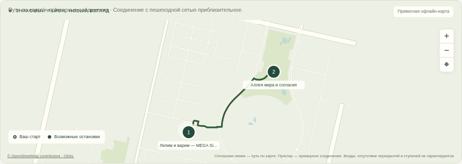

# Qadam · a little more Astana

**ArcSolo · Build with AI · Track 1 / Smart City**

An interactive Astana walking assistant that turns a short break into 1–3 source-backed recommendations and a route that fits the available time, including the walk back. Every place explains its match, visit estimate, suggested activity and data uncertainty.



## Run in one command

Requires **Node 22.9+**. No npm installation or model key is required.

```sh
git clone https://github.com/Csadow/qadam-astana.git
cd qadam-astana
node --env-file-if-exists=.env server.mjs
```

Open **http://127.0.0.1:8787**. The checked-in snapshot makes the local demo independent of public data services. Local serving binds only to loopback. To change the port, set `PORT` in `.env`.

The repository is initially **private**. Judges need repository access, a visibility change, or the prepared source archive. The hosted Site is also owner-private; see [submission status](docs/SUBMISSION.md).

## Try it

1. **An hour near EXPO:** choose a café, park or garden; inspect the two-stop, 60-minute route.
2. **Coffee & a quiet corner:** source-backed cafés, with sockets and quietness explicitly unverified.
3. **A day with the kids:** museum/park candidates with honest uncertainty about hours and interactivity.
4. **A rainy-day escape:** indoor categories using manually selected weather context.
5. Set **15 minutes** to see a clear empty state instead of a fabricated match.

Preset scenarios explicitly simulate afternoon departure. All estimates use Astana UTC+5. EN/RU/KK interface, keyboard controls, opt-in geolocation, mobile layout and itinerary export are included.

## RAG, precisely

```text
Automated OSM collection → normalized source records
    ↓
Browser: BM25 + multilingual concept retrieval
    ↓
Hard constraints: walk, total time, hours, category, accessibility
    ↓
1–3 recommendations + separately optimized short route
    ↓
Optional server: retrieved POIs + limited context → Gemini structured generation
    ↓
Validate source IDs and allowed action IDs → localized activity suggestions
```

Retrieval is sparse and concept-based; there is no vector database. Gemini's generation is deliberately constrained to choosing supported activity IDs. It cannot set factual venue fields or invent a new location. Unknown IDs, unsupported actions, malformed responses, errors and timeouts fall back to approved templates. The app separates sourced facts from suggested actions.

**Current verified mode:** retrieval plus live Gemini structured generation, verified locally and on the private hosted site on 18 October 2026. See [live integration evidence](docs/live-generation-check.json). The UI labels validated model responses as Gemini; missing keys, provider failures and invalid responses fall back to explicitly labelled templates. These smoke checks confirm connectivity and validated output, not model quality.

For a new installation, copy `.env.example` to `.env`, set `GEMINI_API_KEY` locally, and restart the server. Keep the key out of chat, commits and frontend files. Then verify one real call:

```sh
node --env-file=.env scripts/check_gemini.mjs
```

The default model is configurable via `GEMINI_MODEL`. The example uses `gemini-3.5-flash-lite`, listed in the [official model catalog](https://ai.google.dev/gemini-api/docs/models) at implementation time. Consult your project's availability and [structured-output documentation](https://ai.google.dev/gemini-api/docs/generate-content/structured-output). No live provider latency or quality claim is made here.

## Data and privacy

The automated snapshot contains **298 named POIs across five neighborhoods**, collected on 18 October 2026. **102** have opening hours, **26** have wheelchair tags. Short descriptions are labelled source-tag summaries. Each record preserves its OSM ID, source URL, original tags and collection timestamp. [Collection and licensing details](data/README.md).

```sh
python3 scripts/collect_pois.py --osm-api --map  # live alternate collection
python3 scripts/collect_pois.py --from-raw data/raw-osm.json  # reproducible offline rebuild
```

Precise origin coordinates stay in browser memory. No account, location history, analytics or external map tiles. Optional Gemini requests contain public POI records and limited preference flags, not the origin or raw user query. [Privacy and reliability notes](docs/PRIVACY.md).

Walking times are estimates (straight-line distance × 1.3, 75 m/min or 55 in gentle mode), not safe pedestrian navigation. Complex hours remain unknown. Weather is manual. Venue accessibility tags do not verify a step-free route. [Scenarios and full limitations](docs/SCENARIOS.md).

## Verify

```sh
node scripts/build.mjs
node --test tests/*.test.mjs
node scripts/evaluate.mjs
```

**32 unit/API/Worker tests**, a **160-case constraint matrix**, **8/8 scenario checks**, and **17/17 browser checks** passed during development. These are engineering checks, not user-study results. Reports: [scenarios](docs/evaluation.json), [browser](docs/browser-checks.json).

Optional browser QA and presentation tools:

```sh
python3 -m venv .venv
.venv/bin/pip install -r requirements-dev.txt
# With the server running and Chromium at /usr/bin/chromium:
.venv/bin/python scripts/browser_check.py
.venv/bin/python scripts/make_presentation.py
```

## Submission materials

- [Project plan](docs/PLAN.md) — committed before implementation.
- [Russian pitch PDF](presentation/Qadam_ArcSolo_pitch_RU.pdf) and [editable PowerPoint](presentation/Qadam_ArcSolo_pitch_RU.pptx).
- [Russian speaker notes](presentation/SPEAKER_NOTES_RU.md) — 11 slides, target **6:20**, including a live demo.
- [Captioned Russian demo video](presentation/Qadam_demo_RU.mp4), [subtitles](presentation/Qadam_demo_RU.srt), and [YouTube upload copy](presentation/YOUTUBE_UPLOAD.md).
- [Test scenarios](docs/SCENARIOS.md), [English report PDF](docs/Qadam_Test_Scenarios_EN.pdf), [privacy](docs/PRIVACY.md), and [submission checklist](docs/SUBMISSION.md).

## Structure and deployment

`src/` holds pure retrieval, validated generation and HTTP handlers. `public/` contains the dependency-free UI. `scripts/` contains collection, checks, builds, recording and slide generation. `data/` preserves the public snapshot. `tests/` exercises core behavior. `presentation/` contains the actual deliverables.

`node scripts/build.mjs` produces one Cloudflare-compatible ES module at `dist/server/index.js`, with static assets embedded. `.openai/hosting.json` binds the existing private Site. Configure hosted secrets separately; never embed them in the build. Before making a key-enabled service public, add authentication/rate limits and budget controls.

Code: MIT. OpenStreetMap-derived data: ODbL 1.0, © OpenStreetMap contributors. See [LICENSE](LICENSE).
